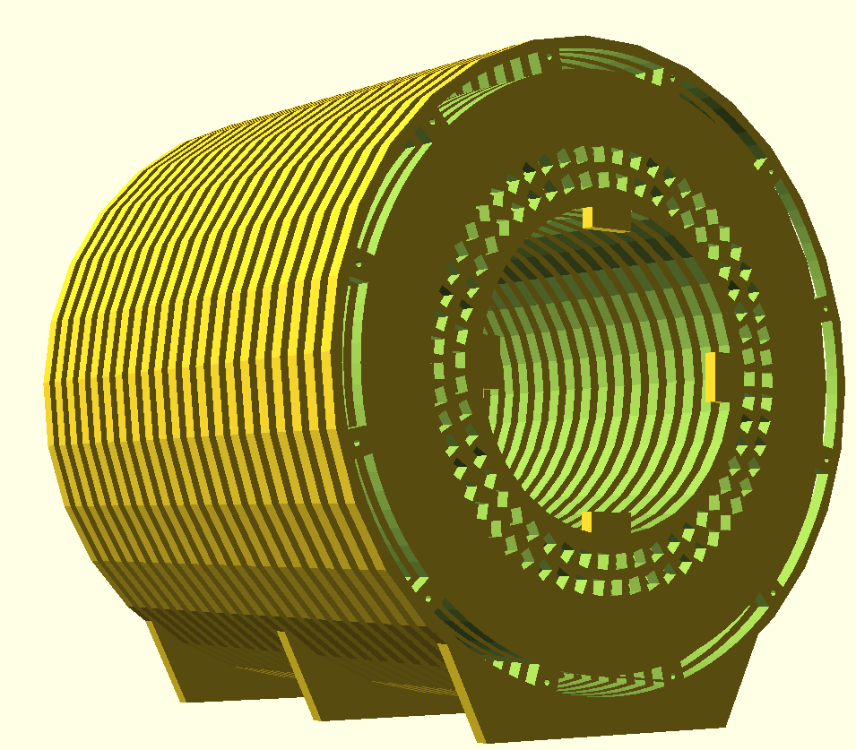
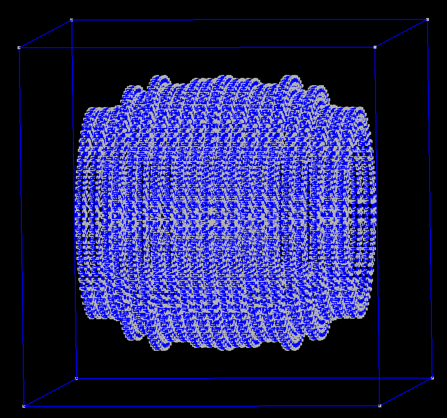
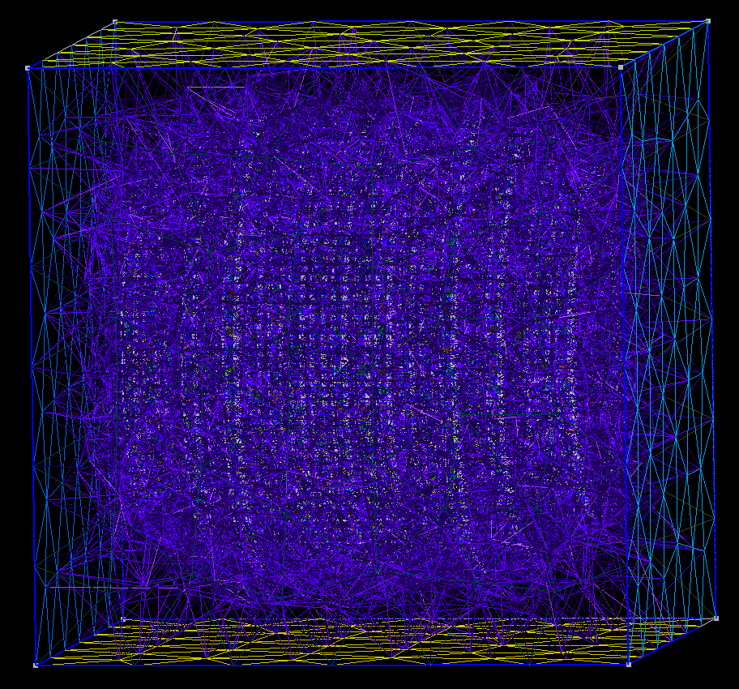
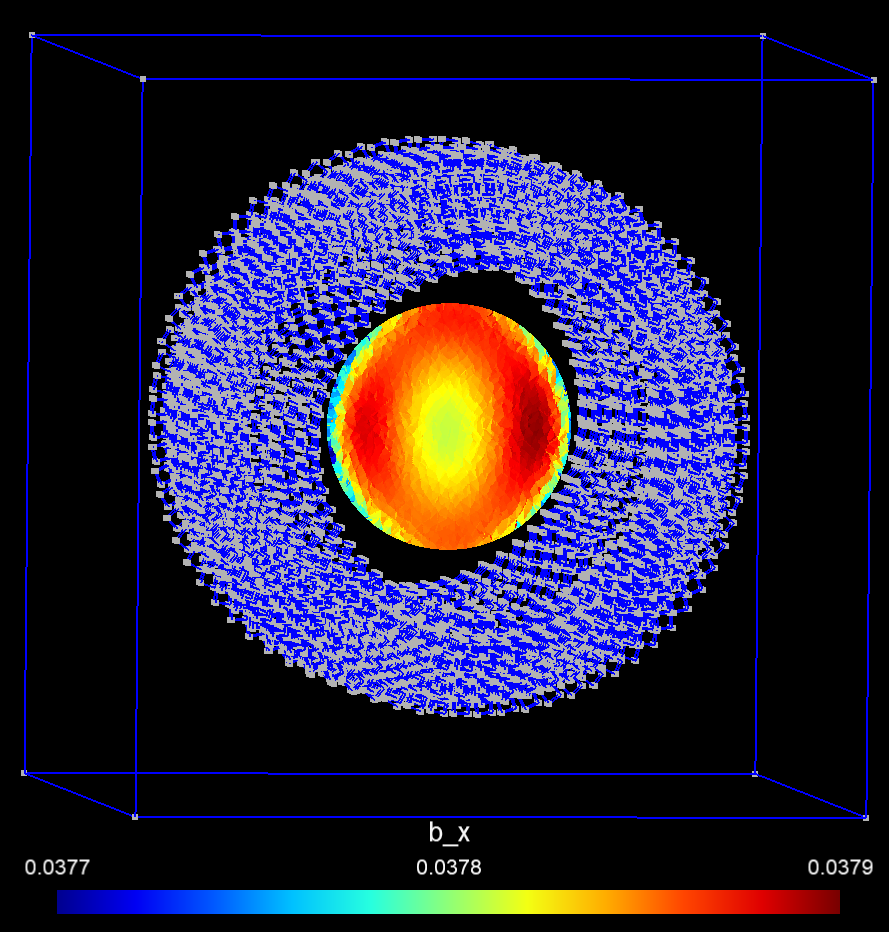

# HalbachMRIDesigner

Parameterized designer for Halbach-cylinder MRI magnets. Given a JSON description of the magnet array, this tool:

- Estimates the field inside a spherical diameter of sensitivity volume (DSV) using dipole superposition
- Plots field contours and magnet orientations at \(z = 0\)
- Exports fabricatable CAD as OpenSCAD (`.scad`) or STEP (`.step`)
- Builds a 3D magnetostatic mesh and solver inputs for FEM

The example in `examples/mri1.json` follows the geometry in O'Reilly et al., *Three-dimensional MRI in a homogenous 27 cm diameter bore Halbach array magnet*, JMR 2019.



## Features

- JSON-driven rings, slices, cube magnets, stands, connection-rod holes, and shim trays
- Optional raw OpenSCAD snippets (`addSCAD` / `subSCAD`) for non-parameterized details such as coil mounting tabs
- Dipole field estimate and homogeneity in ppm over a 20 cm DSV
- OpenSCAD export of the mechanical slices
- STEP export (OpenCASCADE B-rep, AP214, millimetres): one multi-solid assembly plus one file per slice
- FEM mesh generation for sparselizard (GetDP/ONELAB templates are included but not written by default)

## Requirements

- Python 3.8 or newer (3.11 or 3.12 recommended)
- Git (needed once, to install the SolidPython fork)
- Optional:
  - [OpenSCAD](https://openscad.org/) to view `.scad` files
  - FreeCAD, Fusion, SolidWorks, or similar to open `.step` files
  - [sparselizard](https://github.com/catkira/sparselizard/tree/master_next) and [spylizard](https://github.com/catkira/sparselizard-users/tree/master_next) to run FEM
  - [ONELAB](https://onelab.info/) only if you re-enable GetDP export

## Setup

```bash
python3.12 -m venv .venv
source .venv/bin/activate          # Windows: .venv\Scripts\activate
python -m pip install -U pip
python -m pip install -r requirements.txt
```

`requirements.txt` installs `numpy`, `matplotlib`, `gmsh`, `setuptools<81`, and the [catkira SolidPython fork](https://github.com/catkira/SolidPython). `setuptools<81` is required because that SolidPython release still uses `pkg_resources`.

## Usage

```bash
python HalbachMRIDesigner.py examples/mri1.json [options]
```

Every run loads the JSON, evaluates B on a 20 cm DSV at 5 mm resolution, and prints:

```
Max B0 amplitude is … T
Homogeneity: … ppm
```

For `examples/mri1.json` that is about **0.049 T** and **10,300 ppm**.

### Command-line options

| Option | Effect |
| --- | --- |
| `filename` | JSON geometry (required) |
| `--contour` | Contour plot of \(\lvert B\rvert\) at \(z = 0\) |
| `--quiver` | Quiver plot of \(B_{xy}\) at \(z = 0\), with magnet outlines |
| `--scad` | Write `<name>.scad` |
| `--step` | Write STEP assembly and per-slice files |
| `--fem` | Generate mesh and sparselizard solver script |
| `-o NAME` | Output basename (default: JSON filename without extension) |

Examples:

```bash
# Field plots
python HalbachMRIDesigner.py examples/mri1.json --contour --quiver

# OpenSCAD
python HalbachMRIDesigner.py examples/mri1.json --scad

# STEP CAD (recommended for CAM)
python HalbachMRIDesigner.py examples/mri1.json --step

# FEM mesh + solver script
python HalbachMRIDesigner.py examples/mri1.json --fem
```

You can combine flags (`--scad --step --contour`). Run `--fem` in a separate invocation from `--step`; both use Gmsh and can interfere if used together.

## Field calculation

`--contour` and `--quiver` do **not** run FEM. Each cube magnet is treated as a point dipole. The script samples a 20 cm sphere, reports peak \(\lvert B\rvert\) and peak-to-peak homogeneity in ppm, and can plot the \(z = 0\) plane.

This is fast and good for design iteration. Magnet–magnet interaction and the true mechanical housing are not included. Use `--fem` when you need a continuum magnetostatic solution.

## CAD export

### OpenSCAD (`--scad`)

Writes `<name>.scad` (see `examples/cylinder.scad` for a reference). Open it in [OpenSCAD](https://openscad.org/).

To take a `.scad` file into FreeCAD:

1. In OpenSCAD: **Edit → Preferences → Advanced**
   - Turn off rendering at `1000000`
   - CGAL cache size `1000`
   - PolySet cache size `1000`
2. Open the `.scad` file
3. **File → Export → CSG**
4. Import the `.csg` file into FreeCAD

### STEP (`--step`)

Writes native B-rep STEP (AP214, millimetres), suitable for milling or 3D printing without the OpenSCAD → CSG → FreeCAD path:

- `<name>.step` — assembly with one solid per slice
- `<name>_slices/slice_00_z220mm.step` … — one file per slice

The STEP model matches the parameterized geometry: discs, stands, magnet pockets, rod holes, and shim trays. Custom `addSCAD` / `subSCAD` is included when it uses only `translate`, `rotate(a=…)`, and `cube`. More complex raw OpenSCAD still needs `--scad`.

Do not commit generated `.step`, `.scad` (except the example), meshes, or `*_slices/` directories; they are listed in `.gitignore`.

## JSON geometry

Lengths in the JSON are millimetres. Internally the code converts to metres. `examples/mri1.json` is the full 27 cm-bore example.

| Field | Meaning |
| --- | --- |
| `magnets[]` | Magnet types. Only `shape: "cube"` is supported. `dimension` (mm), `BR` (T), `mur` |
| `defaultMagnetType` | Index into `magnets` |
| `rings[]` | Reusable rings: `id`, `radius` (mm), `numMagnets` |
| `slices[]` | Axial plates: `position`, `innerRadius`, `outerRadius`, `rings` (by id) |
| `mirrorSlices` | If true, every slice with \(z \neq 0\) is mirrored to \(-z\) |
| `standWidth`, `standHeight` | Global end-plate feet (mm). Per-slice values override; `0` omits the stand |
| `numConnectionRods` | Count of through-holes |
| `connectionRodsArcRadius` | Radial position of the rods (mm) |
| `connectionRodsDiameter` | Rod hole diameter (mm) |
| `addSCAD`, `subSCAD` | Optional raw OpenSCAD added to / subtracted from a slice |

Ring magnetizations follow a double-angle Halbach law: a magnet at azimuth \(\theta\) is oriented at \(2\theta\).

## FEM simulation

`--fem` builds magnet cubes (not the plastic slices) inside a 600 mm air box, meshes them, and writes solver inputs. It does **not** solve the field.

Outputs:

| File | Role |
| --- | --- |
| `<name>.msh` | 3D mesh, Gmsh format v2 |
| `<name>.geo` | Geometry for the Gmsh GUI |
| `<name>.geo.opt` | Gmsh view options |
| `<name>.pickle` | Per-magnet \(B_R\), \(\mu_r\), angle, region IDs |
| `<name>.py` | Generated sparselizard script |





### Run with sparselizard (supported path)

1. Build and install [sparselizard `master_next`](https://github.com/catkira/sparselizard/tree/master_next) and [spylizard `master_next`](https://github.com/catkira/sparselizard-users/tree/master_next).
2. Generate files: `python HalbachMRIDesigner.py examples/mri1.json --fem`
3. From this directory: `python mri1.py`

The script solves magnetostatics with a magnetic scalar potential \(\phi\):

- \(-\nabla\cdot(\mu\nabla\phi)=0\) in air
- magnets contribute remanence \(\mathbf{B}_r\)
- \(\phi=0\) on the air-box boundary
- \(\mathbf{H}=-\nabla\phi\), \(\mathbf{B}=\mu\mathbf{H}-\mathbf{B}_r\)

Results (open the `.pos` files in Gmsh):

- `<name>_sparselizard_b.pos` / `_h.pos` — volume fields
- `<name>_interpolated_b_sphere.pos` — B on the 20 cm DSV
- `<name>_interpolated_b_z0.pos` / `_h_z0.pos` — \(z=0\) slice

`examples/mri1.json` is a large 3D problem (thousands of cubes). Start with a 1–2 ring JSON if you want a quicker mesh.

### GetDP / ONELAB (optional, disabled)

`templates/cylinder_template.pro` and `templates/common_template.pro` implement H- and A-formulation magnetostatics for GetDP. They are **not** written unless you set `generateONELABfile = True` in `HalbachMRIDesigner.py`. After that, generate with `--fem` and open the `.pro` file in [ONELAB](https://onelab.info/).

## Project layout

```
HalbachMRIDesigner.py   # CLI
HalbachCylinder.py      # Array, JSON load, SCAD/STEP export
HalbachSlice.py         # One axial plate
HalbachRing.py          # One Halbach ring and FEM magnet boxes
Magnet.py               # Dipole magnet + 2D plot
CubeMagnet.py           # Cube magnet type (size, BR, mur)
examples/mri1.json      # 27 cm-bore example
examples/cylinder.scad  # Reference OpenSCAD output
templates/              # sparselizard and GetDP templates
```

## License

[GNU General Public License v3.0](LICENSE)

## Contributions

- Benjamin Menkuec (code and ideas)
- Lukas Winter (ideas)
- Thomas O'Reilly (ideas, [HalbachOptimisation](https://github.com/LUMC-LowFieldMRI/HalbachOptimisation))
