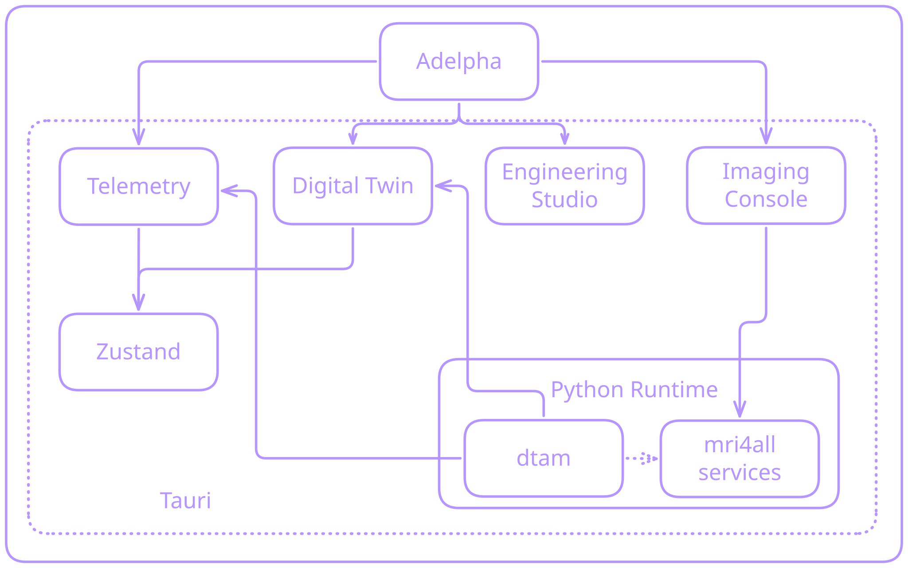

# Architecture

The GUI is an **observer + operator client** organized into **workspaces**. Twin telemetry is read from the Twin HTTP API. Sensor boards are WebSocket **clients** of Adelpha; they do not call that HTTP port. Agents chat uses Google ADK’s API server. The Imaging Console uses a FastAPI façade in this repo; closed-loop imaging I/O stays in Python (FLOCRA / MaRCoS), not in TypeScript. Arduino serial stays in a user Python bridge.

In the **desktop app** those three APIs are one supervisor process (dynamic port, session token). Browser-only Vite still uses fixed ports. See [Getting started](../start/index.md).

Python libraries and vendor trees live under `sidecar/` (public `adelpha` package, DTAM, imaging console, coil/RF/shim/Halbach/FEM). The desktop supervisor stays in `runtime/python/`.

<figure class="adelpha-preview">
  
</figure>

## Workspace routing

`App.tsx` holds `workspace: WorkspaceId` (`digital-twin` | `imaging-console` | `engineering-studio`). Launch workspace comes from [Workspace settings](configuration.md#persisted-ui-preferences): last used if **Restore layout** is on, otherwise **Startup workspace**.

| Workspace | Main content |
| --- | --- |
| `digital-twin` | Viewport + resizable side panel + bottom console |
| `imaging-console` | Full-width `ImagingConsole` |
| `engineering-studio` | Project workspaces for assemblies, magnet fields, STEP-based FEM, coils, and shimming |

Alt workspaces keep the Digital Twin WebGL canvas mounted (hidden and paused) so orbit and CAD view survive a switch. The telemetry panel is hidden.

## Client modules

| Module | Responsibility |
| --- | --- |
| `src/twin/TopbarControls.tsx` | System Context dropdown, workspace switcher (⌘K), app menu |
| `src/twin/workspacePrefs.ts` | Persisted startup workspace / restore layout / panel width |
| `src/twin/ImagingConsole.tsx` | Imaging Console shell (viewers + sequence editor) |
| `src/twin/EngineeringStudio.tsx` | Engineering Studio shell, CAD viewport, and view controls |
| `src/twin/Mri4allWindows.tsx` | Status, Log, Config, Study Viewer, Flex |
| `src/twin/mri/api.ts` | Console and engineering API clients |
| `src/twin/studio/ElmerStepStudio.tsx` | STEP-based FEM setup, jobs, and viewer navigation |
| `src/twin/studio/FemFieldPreview.tsx` | In-app field surfaces, sections, probes, and exports |
| `runtime/python/adelpha_runtime/fem.py` | FEM uploads, background jobs, and result routes |
| `sidecar/simulation/fem/` | Gmsh meshing, Elmer solving, and preview data |
| `src/twin/consoleTheme.ts` | Shared Adelpha, MRI4ALL, Porcelain, and Glacier themes |
| `src/twin/scannerModel.ts` | Bundled + imported scanner profiles |
| `src/twin/importedModels.ts` | GLB import (IndexedDB) |
| `src/twin/settings/DtamSetupSection.tsx` | Twin scanner, environment, Agents key |
| `src/twin/settings/DeviceLinkSection.tsx` | Device listener status and Physical control |
| `src/twin/dtamApi.ts` | Twin: health, state, forecast, assess, sensors, devices |
| `sidecar/python/adelpha/` | Public PyPI package: `telemetry` (sensors), `feedback` (control), twin, magnet, coil, FEM |
| `sidecar/dtam/src/dtam/communication/` | JSON-RPC device protocol, WebSocket hub, internal client used by `adelpha.telemetry` |
| `src/twin/adkApi.ts` | Agents: sessions, SSE / run, list-apps, artifacts |
| `src/twin/dtamTypes.ts` | TypeScript mirrors of `SystemState` / quantities |
| `src/twin/telemetryStore.ts` | Poll driver, forecast / assess actions, scene mapping |
| `src/twin/SystemConsole.tsx` | Logging + Terminal tabs |
| `src/twin/TwinTerminal.tsx` | xterm.js: browser builtins or Tauri PTY |
| `src/twin/AgentChatPanel.tsx` | Agents side panel (markdown, plots, motion share) |
| `src/twin/CameraFeed.tsx` | MediaPipe head pose + motion HUD |
| `src/twin/headMotionStore.ts` | Head motion recorder + agent share bridge |
| `src/twin/ViewportToolRail.tsx` | Draggable viewport tool selector |
| `src/twin/launch/LaunchScreen.tsx` | Session intro animation |
| `src/App.tsx` | Shell composition: store reads, workspace routing, layout wiring |
| `src/twin/shell/` | Topbar, twin viewport, settings overlay, lazy workspace chunks |
| `src/twin/dashboard/` | Live dashboard grid, expanded charts, noise/DFT maths, series hook |
| `src/twin/panel/` | Side panel shell, panel layout hook, telemetry cards |
| `sidecar/console/services/api/app.py` | MRI FastAPI façade |

## FEM simulation

[FEM projects](fem.md) use their own imported STEP solids. The client submits jobs through `/api/magnet/fem`; worker processes run Gmsh and Elmer. Mesh and field previews are served separately from the downloadable result archive. The UI polls job status and opens Results after a successful solve.

## Polling vs forecast

- **Poll** `GET /twin/state` without a horizon so live channels stay cheap.
- **Forecast** only on explicit user action (`POST /twin/forecast` with `predict_horizon_s > 0`).
- Predicted scalars stay `null` until a horizon is requested; the UI must not style them as measurements.

## Scene mapping

`systemStateToTelemetry()` projects twin fields into the compact `TwinTelemetry` shape the 3D magnet still consumes (e.g. \(B_0\) in mT, magnet / room temperatures, RF noise floor). The side panel always reads nested `SystemState` quantities (`state.thermal?.mean_magnet_temperature_c?.value`, …).

## Desktop shell

Tauri v2 (`src-tauri/`) loads the Vite UI, spawns `adelpha-python-runtime`, and exposes a real PTY. Camera uses `NSCameraUsageDescription` plus the hardened-runtime camera entitlement. Imported CAD and MediaPipe WASM need the production CSP (`blob:`, `wasm-unsafe-eval`, `mediastream:`). See [Desktop packaging](../packaging/index.md) and [Settings](settings.md).

## Related

[MaRCoS](../about/marcos.md) · [MRI4ALL](../about/mri4all.md) · [Digital twins](../about/digital-twins.md) · [Device link](devices.md) · [Sequences](../about/sequences.md) · [Reconstruction](../about/reconstruction.md)
