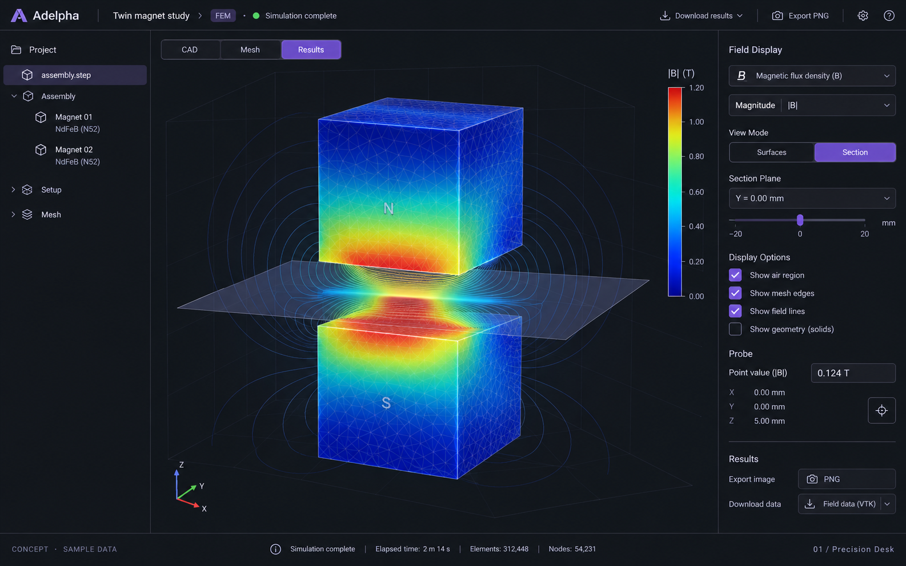
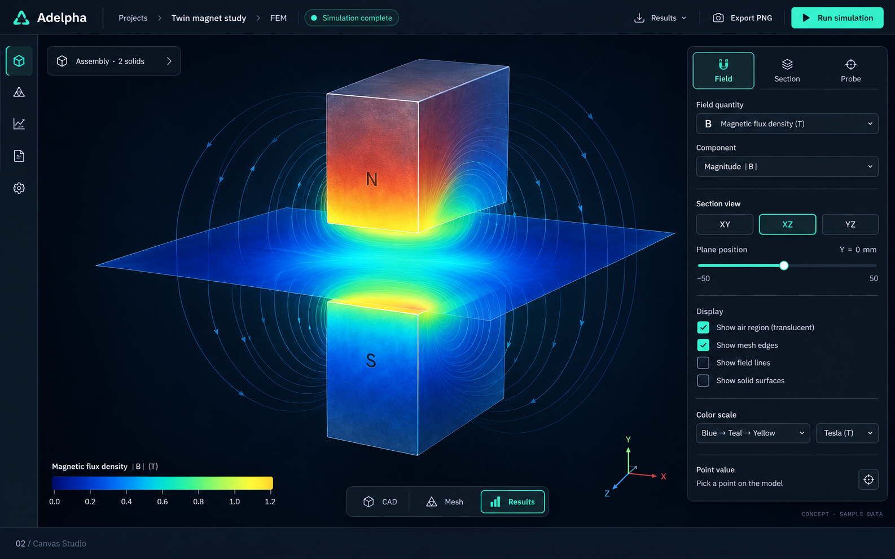
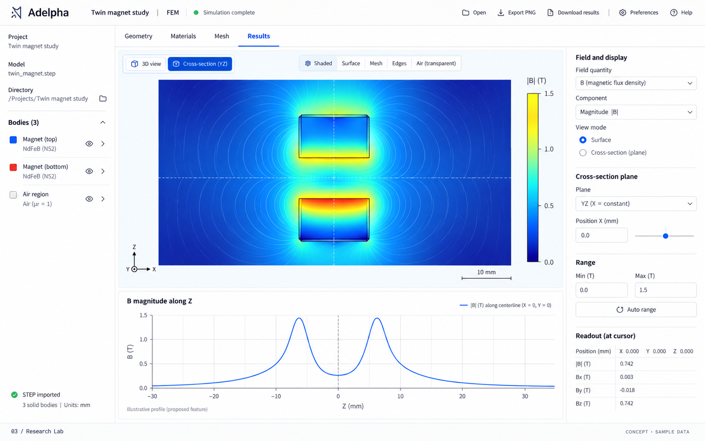
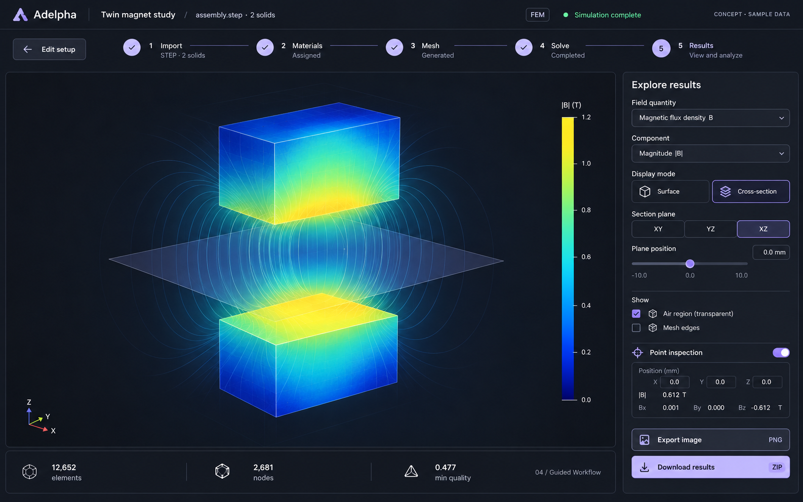
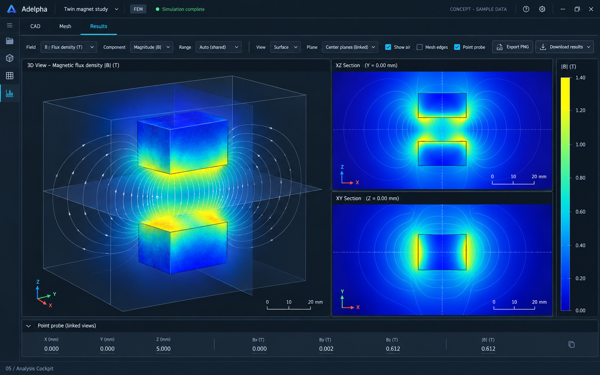

# Adelpha FEM interface concepts

Five alternatives generated with the built-in image-generation tool. These are visual concepts, not app changes or computed scientific results. Field lines, profile plots and linked views shown here are proposed features. Logos, labels and illustrated values are provisional; implementation should retain Adelpha's existing identity and show real solver data.

| Design | Direction | Main tradeoff |
| --- | --- | --- |
| 01 Precision Desk | Project tree, clear canvas, dedicated inspector | Familiar and practical; two side panels |
| 02 Canvas Studio | Large canvas, collapsed assembly, compact tool dock | More model space; setup takes an extra click |
| 03 Research Lab | Light theme, section and field-profile plot | Strong for quantitative analysis; proposed profile feature |
| 04 Guided Workflow | Horizontal setup stages, one results inspector | Clean and approachable; less persistent assembly navigation |
| 05 Analysis Cockpit | Coordinated 3D and two sectional views | Powerful inspection; higher density and more implementation work |

Recommended starting point: 01 for a polished evolution of the current workbench, or 04 for the clearest workflow.

Full generation specifications: [prompts.json](prompts.json).

